<div align="center">

# 📬 NoticeAction 通知行动台

### 把散落在 PDF、Excel 和群截图里的学校通知，变成孩子专属的行动清单

先读懂通知，再核对变化，最后明确“谁、何时、带什么、做什么”。<br>
面向 TextIn xParse「文档觉醒」AI 应用创新赛的可运行作品。


</div>

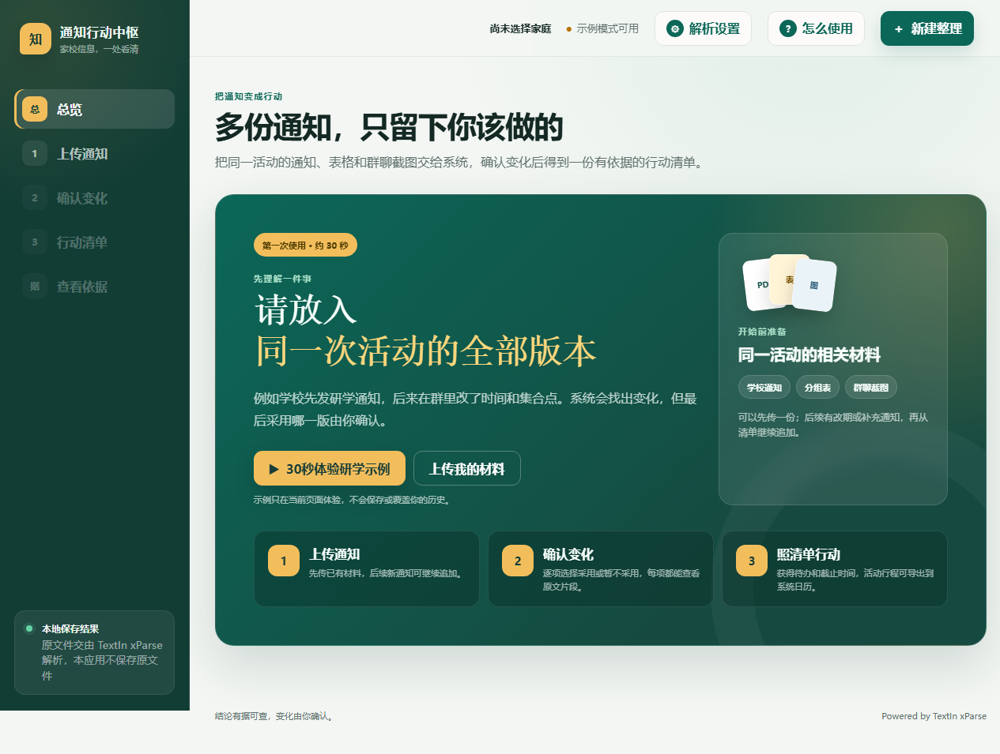

## 它解决什么问题

一场研学活动的信息可能散落在正式通知、班级分组表、群聊补充截图和临时变更中。家长真正需要的并不是“再读一遍文档”，而是三个确定答案：

- **我的孩子是否参加、属于哪一组？**
- **最新版到底改了什么，旧要求是否已经失效？**
- **最后要在什么时间前，准备哪些物品、完成哪些动作？**

NoticeAction 将多种通知放进同一个活动上下文，保留出处和人工确认环节，输出可以直接执行的个人清单，而不是一段泛泛的 AI 摘要。

## 三步完成一次整理

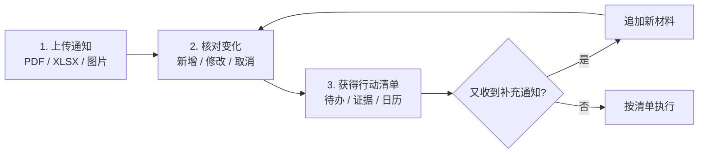

<table>
  <tr>
    <td width="50%">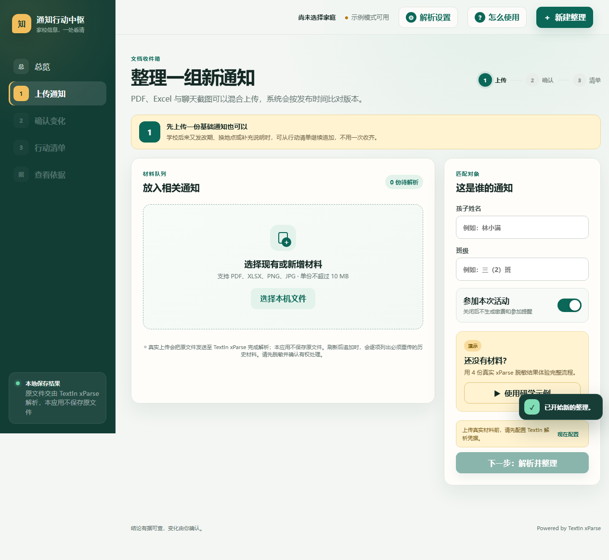</td>
    <td width="50%">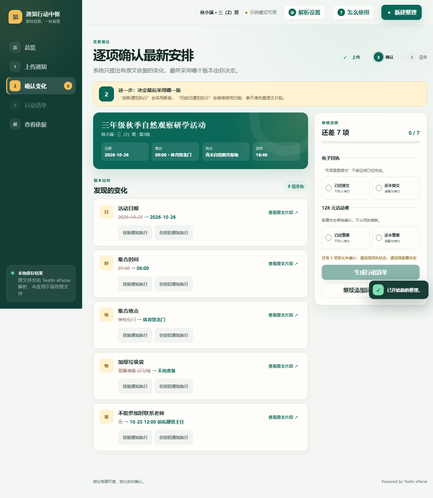</td>
  </tr>
  <tr>
    <td align="center"><b>① 混合上传通知材料</b></td>
    <td align="center"><b>② 逐项确认变化与冲突</b></td>
  </tr>
</table>

## 最终成果不是摘要，而是行动台

系统会把日期、地点、个人物品、分组物资、条件动作、回执与缴费分别整理；每个结论都可以回到原文件、页码和元素位置查看依据。确认后还可导出 `.ics` 日历。

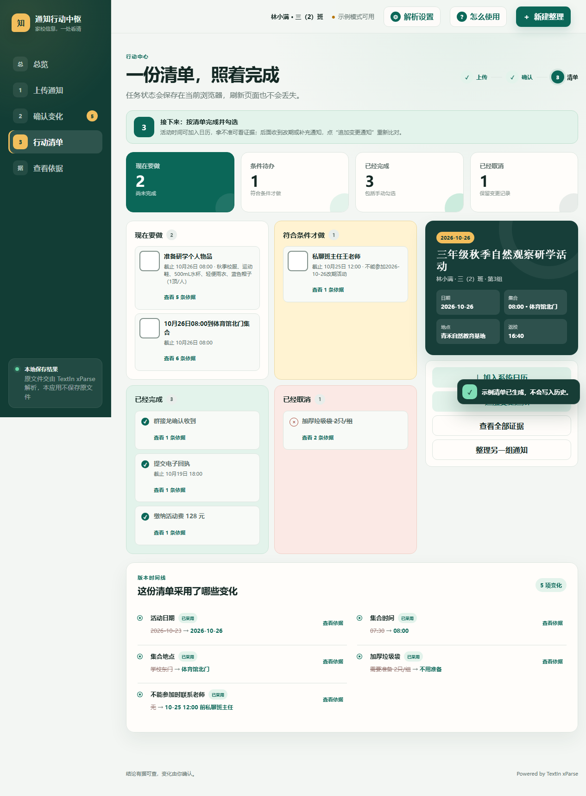

## 核心能力

| 能力 | 实际作用 |
|---|---|
| 多格式联合解析 | PDF、XLSX、PNG、JPG 可以混合上传，通过 TextIn xParse 还原正文和表格 |
| 个人化匹配 | 结合孩子姓名、班级和是否参加，过滤与当前家庭无关的信息 |
| 变更识别 | 对新增、修改、取消和互相冲突的要求逐项确认，不静默覆盖旧通知 |
| 增量追加 | 清单生成后可继续上传补充通知，只重新分析新增材料并与基线比对 |
| 可追溯证据 | 每项结论保留文件名、页码、元素 ID 和必要原文片段 |
| 可执行交付 | 生成按时间排序的行动清单，并导出标准日历文件 |
| 本地优先 | 服务仅监听本机；原文件、完整解析文档和供应商原始响应不持久化 |

### 历史活动可以继续追加

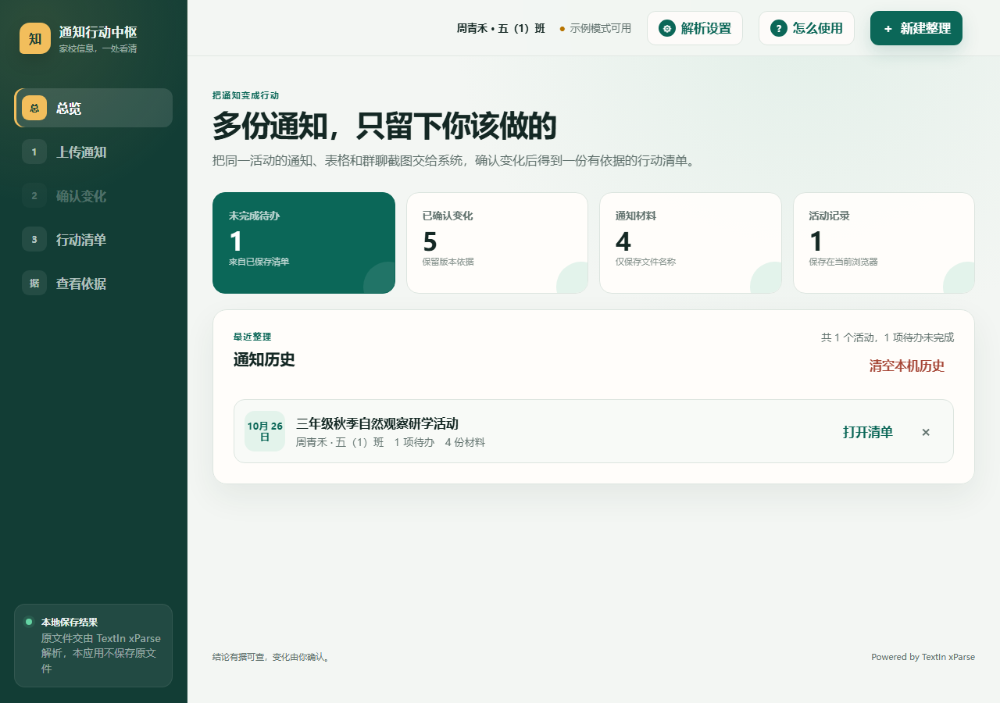

### 每条结论都能回到通知依据

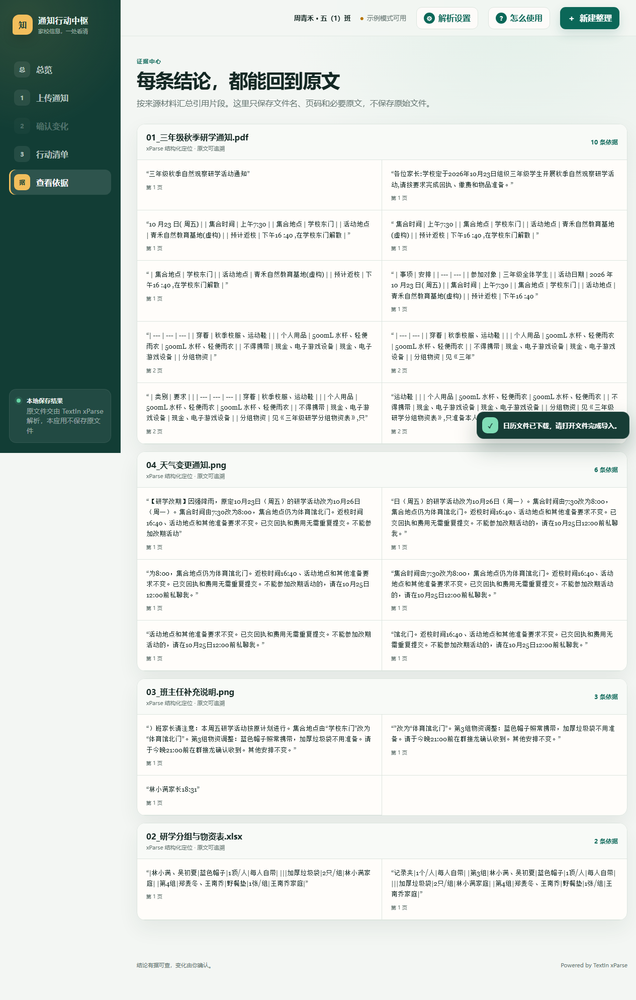

## 30 秒跑起来

> 环境要求：Windows 10/11，Node.js 22 或更高版本。项目没有第三方运行依赖，无需 `npm install`。

```powershell
git clone https://github.com/xiaosongxiaosong1111/NoticeAction.git
cd NoticeAction
```

然后双击 **`start-hidden.vbs`**。程序会在后台启动本地服务并打开：

```text
http://127.0.0.1:43173
```

首次体验可以直接点击首页的 **“30 秒体验研学示例”**。示例来自真实 xParse 返回值的脱敏快照，不消耗解析额度，也不会覆盖真实历史。

如果需要观察启动日志或排查问题：

```powershell
npm start
```

## 使用真实 TextIn xParse

1. 打开右上角 **“解析设置”**。
2. 输入 TextIn `AppID` 和 `Secret Code`，点击 **“保存并启用”**。
3. 点击 **“新建整理”**，上传通知并填写孩子姓名、班级及是否参加。
4. 解析后核对变化，生成个人行动清单。
5. 后续收到新通知，按 **“总览 → 打开清单 → 追加变更通知”** 进入；若页面未刷新，只需上传新文件。

凭据由 Windows DPAPI（CurrentUser）加密后保存在当前用户的本机目录，不写入项目、Git、浏览器存储或日志；页面与接口只返回“是否已配置”，不会回显明文。

<details>
<summary><b>查看更多真实界面截图</b></summary>

### 凭据设置（移动端）

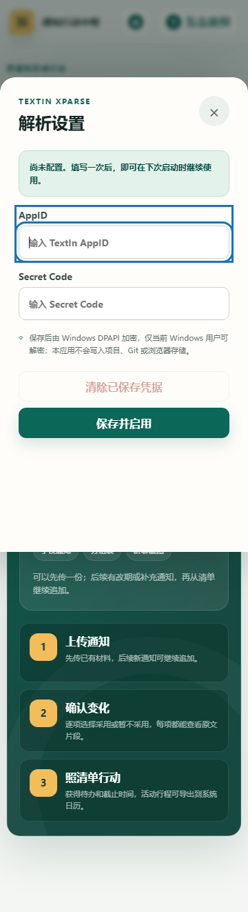

### 未保存内容保护

新建整理前若存在待上传文件、填写中的身份信息、已生成分析或正在解析的任务，系统会先说明将被丢弃的内容；取消后保留原状态并恢复键盘焦点。

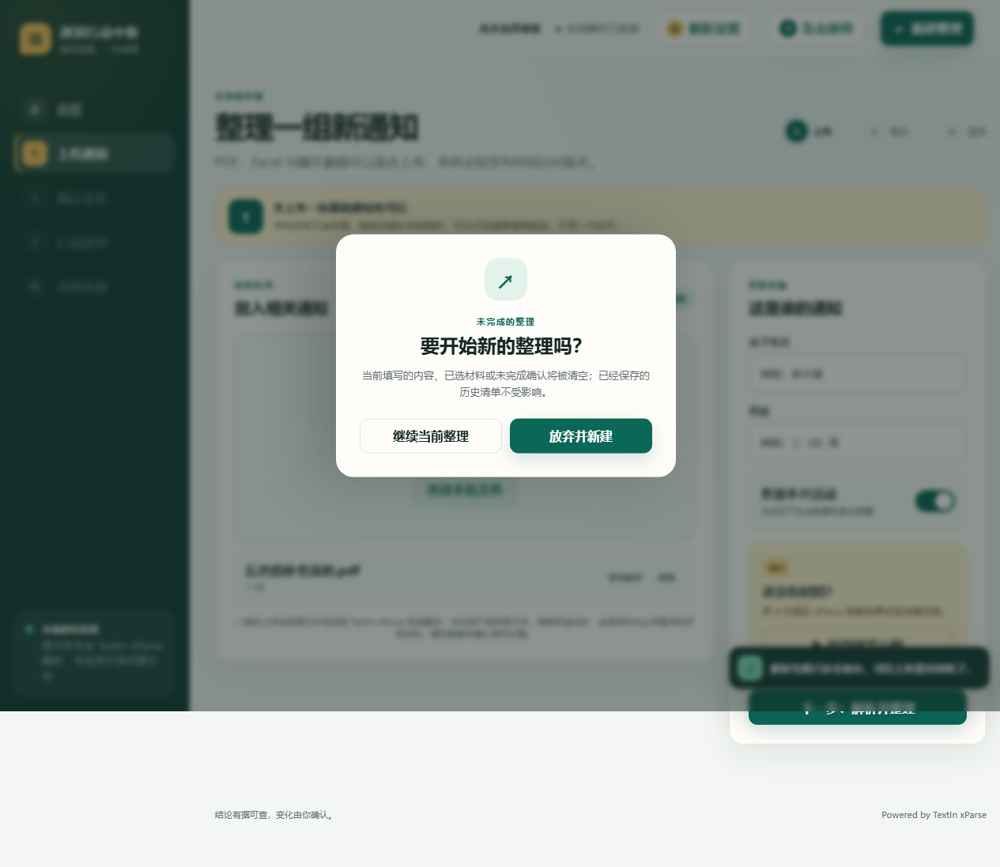

### 移动端行动清单


### 内置使用指南

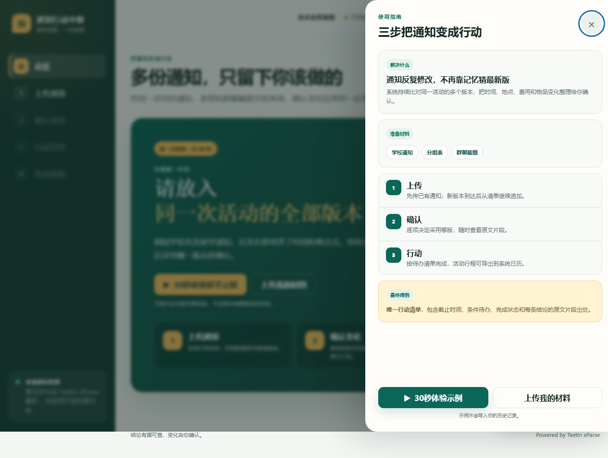

</details>

## 数据流与隐私边界

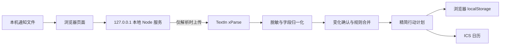

- 单文件上限 10 MiB，同一活动最多 20 份；仅接受 `.pdf`、`.xlsx`、`.png`、`.jpg`、`.jpeg`。
- 服务只监听 `127.0.0.1`，并拒绝非本机 Host、跨站 Origin 和可绕过预检的简单上传类型。
- 历史只保存最终精简计划及必要证据，可逐条删除、一键清空或清理站点数据。
- 当前会话可以直接追加文件；刷新页面后完整解析正文已被清除，因此继续比对时必须按提示重传历史原材料。
- 上传真实材料前请移除不必要的姓名、联系方式等个人信息，并确认拥有处理权限。

## 项目结构

```text
NoticeAction/
├─ server.mjs                 # 本地 HTTP 服务与安全边界
├─ src/
│  ├─ credential-store.mjs   # Windows DPAPI 凭据存储
│  ├─ merge.mjs              # 跨文档比对、冲突与行动清单
│  └─ xparse-client.mjs      # xParse 调用与响应脱敏
├─ static/                    # 零框架前端与增量整理逻辑
├─ samples/                   # 虚构演示材料和脱敏解析快照
├─ tests/                     # 单元、集成与边界测试
├─ scripts/browser-smoke.mjs # 浏览器关键流程与截图
└─ artifacts/screenshots/    # README 与参赛展示截图
```

## 验证

```powershell
npm test
npm run coverage

# 先 npm start，再开一个终端
npm run e2e
```

当前基线：**71 项测试通过，行覆盖率 98.20%**。浏览器流程还会校验首次指引、示例隔离、文件追加、未保存内容保护、键盘焦点、移动端触控尺寸、历史清理和日历导出。

## 当前边界

这是一个可本地运行、可现场演示的完整单用户系统，不是只有静态页面的概念 Demo。当前语义规则聚焦学校研学通知，不宣称覆盖所有学校与所有文书写法；也暂不包含账号、多用户同步、数据库和公网托管。扩展为正式产品时，还需要更多真实脱敏样本评测、通用结构化抽取和服务端身份认证。

---

<div align="center">

**让通知不止被读懂，更真正变成下一步行动。**

Built with TextIn xParse · Local-first by design

</div>
